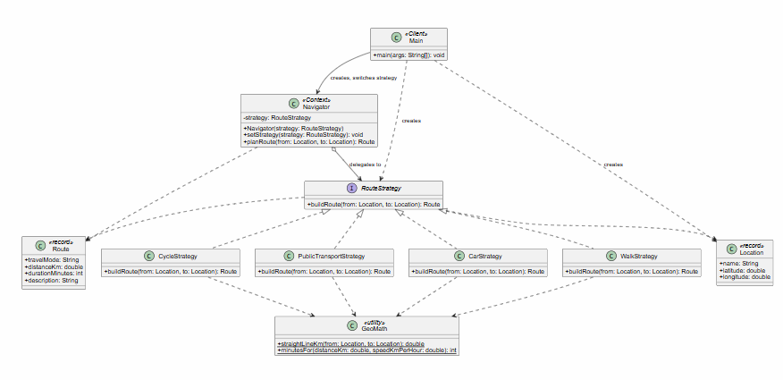

# Assignment #5 — Strategy Pattern

**Student:** Abylai Duisim, SE-2530

## 1. Introduction

**Domain:** navigation / route planning (Option A). **Algorithm family:** "build a route between two points". The way a route is calculated depends on the travel mode: a car follows roads at city speed, a pedestrian walks short paths slowly, a cyclist uses bike lanes, a bus ride includes waiting time. These are different algorithms with the same goal and the same inputs/outputs, so they are a natural fit for Strategy.

Without the pattern, `Navigator.planRoute()` would contain an `if / else if` chain on the travel mode, and every new mode would force editing it. With Strategy, each mode is a separate class behind the `RouteStrategy` interface, and the `Navigator` simply delegates.

## 2. UML class diagram



## 3. Clean Code principles (Clean Code, Ch. 10)

### 3.1 Polymorphism instead of conditional logic

Before:
```java
public Route planRoute(String mode, Location from, Location to) {
    if (mode.equals("car")) {
    } else if (mode.equals("walk")) {
    } else if (mode.equals("cycle")) {
    }
}
```
After:
```java
public Route planRoute(Location from, Location to) {
    return strategy.buildRoute(from, to);
}
```
The choice of algorithm is made by the object type, not by a branch. Even the client selects strategies through `Map<String, RouteStrategy>` rather than `switch`.

### 3.2 Meaningful, intention-revealing names

`CarStrategy`, `WalkStrategy`, `CycleStrategy`, `PublicTransportStrategy`, `buildRoute`, `straightLineKm`. Constants have names instead of magic numbers:
```java
private static final double ROAD_DETOUR_FACTOR = 1.3;
private static final double AVERAGE_CITY_SPEED_KMH = 40.0;
```
Compare with `distance * 1.3 / 40 * 60`, which says nothing.

### 3.3 Single Responsibility Principle

Each strategy has one reason to change: its own algorithm. `CarStrategy` does not know about walking; `Navigator` does not know how routes are computed; `Main` does not do calculations.
```java
public class WalkStrategy implements RouteStrategy {
   
}
```

### 3.4 Context is algorithm-agnostic

`Navigator` imports only `RouteStrategy`, never a concrete class:
```java
public class Navigator {
    private RouteStrategy strategy; 
    public Route planRoute(Location from, Location to) { return strategy.buildRoute(from, to); }
}
```
Any object implementing the interface, even a lambda in the tests (`(from, to) -> new Route(...)`), works without changing the context.

### 3.5 Open/Closed: easy extensibility

`PublicTransportStrategy` was added in a separate commit. Changes needed: one new file and one line in the client (`Main`).
```java
strategies.put("bus", new PublicTransportStrategy()); 
```
`Navigator`, `CarStrategy`, `WalkStrategy` and `CycleStrategy` were not touched.

### 3.6 No duplication (DRY) and fail-fast validation

The Haversine formula and the speed-to-minutes conversion live once in `GeoMath` rather than being copied into four strategies. `Navigator.setStrategy` rejects `null` immediately with `Objects.requireNonNull`, so an invalid state cannot appear.

## 4. Strategy vs. State

Both patterns have a context that delegates to an interchangeable object behind an interface, and their UML looks almost identical. The difference is intent. In **State**, the object changes its own behavior as its internal state changes, the states usually know about each other and trigger transitions (e.g. an order going New → Paid → Shipped). In **Strategy**, the **client** chooses the algorithm from outside, the strategies are independent of each other, and nothing "transitions" between them.

My problem calls for Strategy: the travel mode is an external choice made by the user, car/walk/cycle/bus do not switch each other, and they are simply alternative ways to do the same job. The `Navigator` has no lifecycle; it is not in a "car state" that leads to a "walk state".

## 5. Conclusion

Strategy gave flexibility: new travel modes can be added without modifying the `Navigator`, strategies can be swapped at runtime, and each algorithm can be tested separately. The price is more classes (one interface plus four strategies instead of one method with branches) and the need for the client to know which strategy to choose. For three or four algorithms that grow over time this is clearly worth it; for a single stable algorithm it would be over-engineering.

## 6. GitHub repository

https://github.com/Abylaisdb/Assignment-5-Strategy-Pattern
